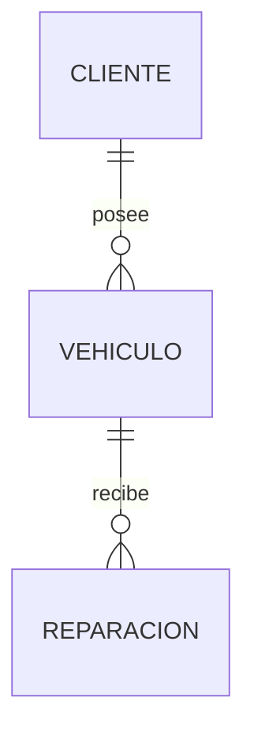
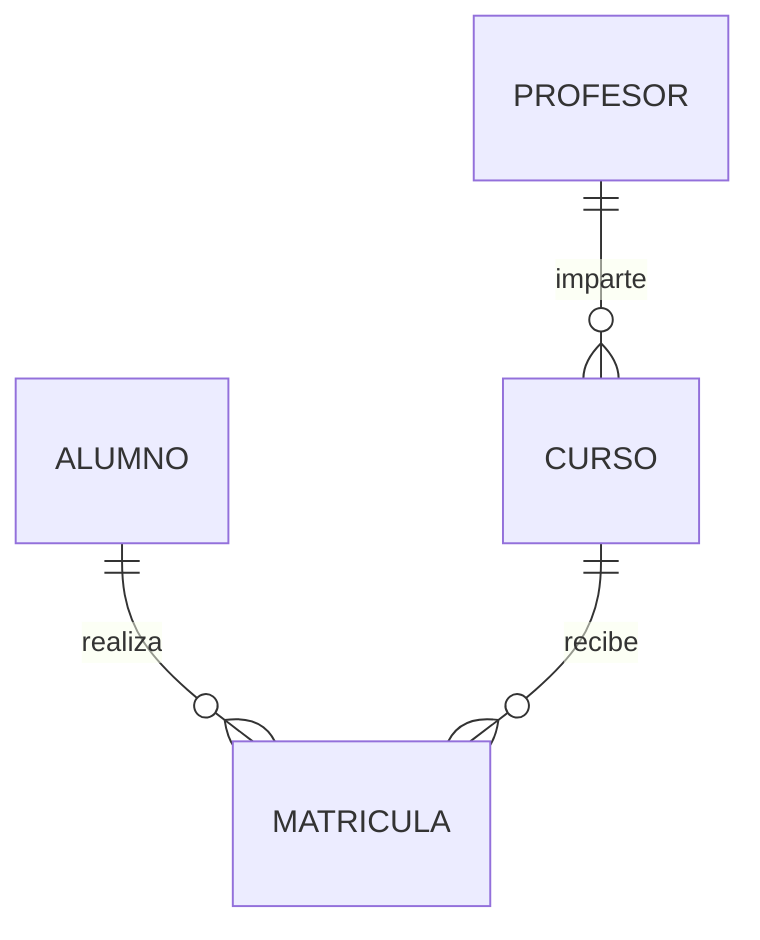
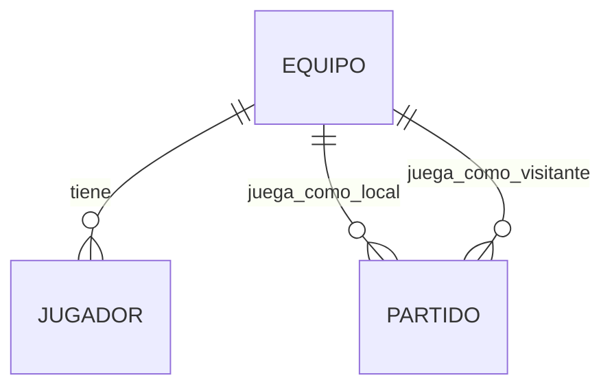
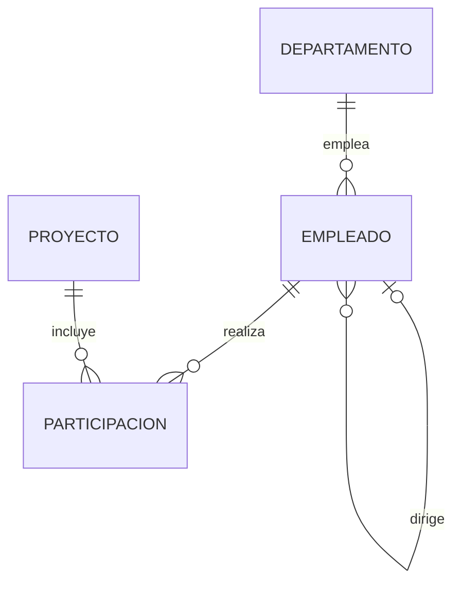
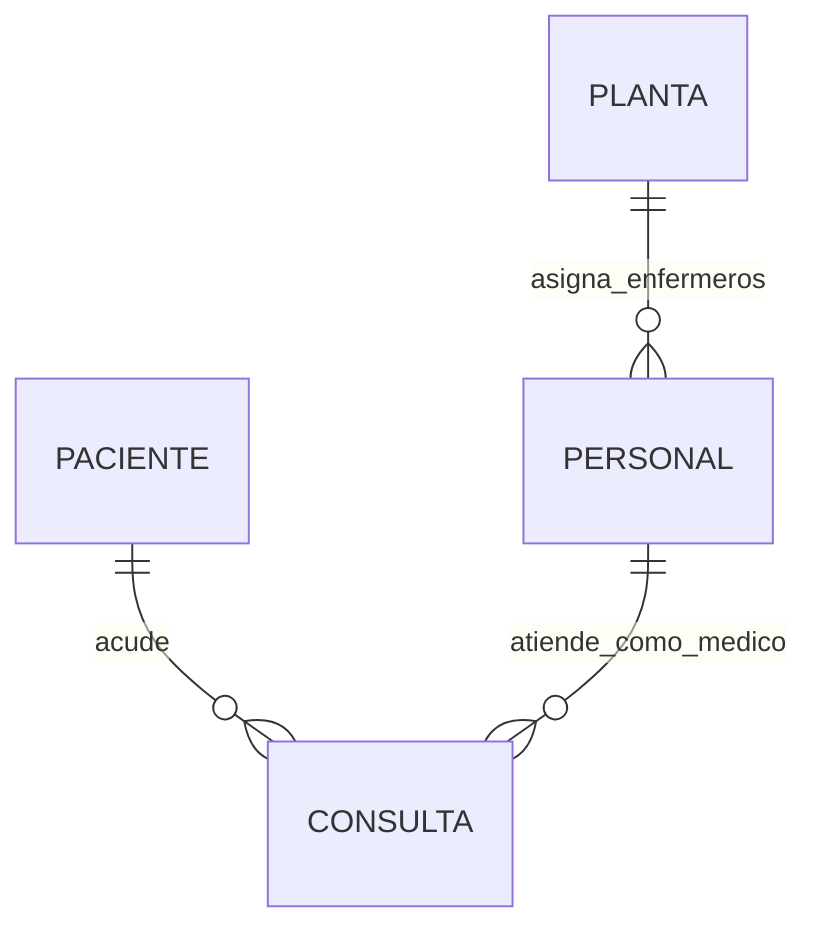
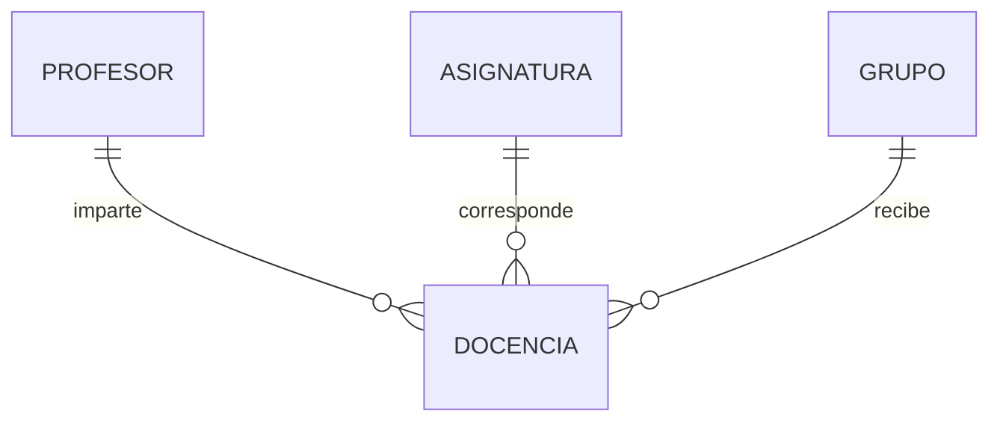
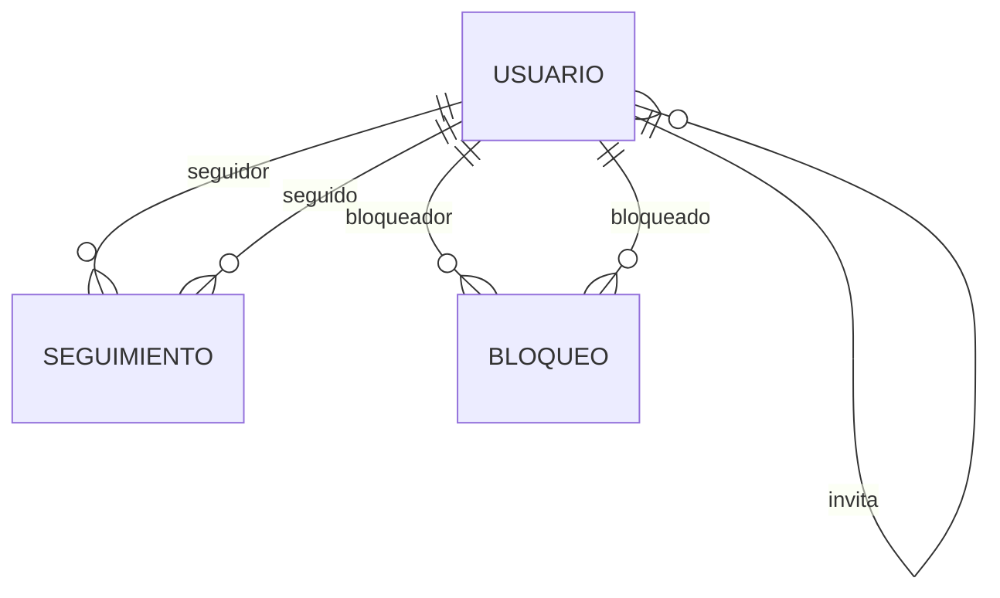
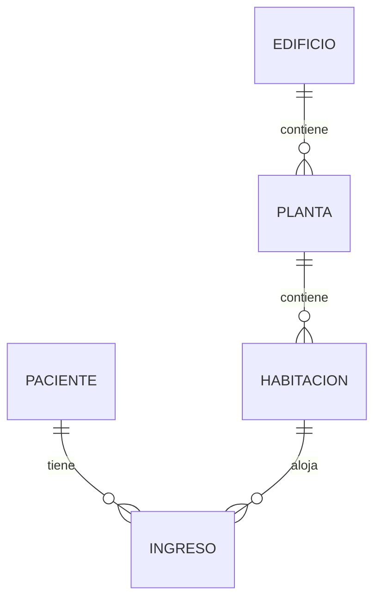

# Soluciones: Modelo E/R

Las soluciones usan PostgreSQL y un esquema (`CREATE SCHEMA`) independiente
para cada ejercicio. El script DDL completo está en
[modelo_er_soluciones.sql](./modelo_er_soluciones.sql).

## Ejercicio 1: Taller mecánico

**Entidades:** `cliente` (DNI, nombre, teléfono), `vehiculo` (matrícula, marca,
modelo) y `reparacion` (número, fecha de entrada, avería, importe).

**Relaciones y cardinalidades:**

- `cliente` — `vehiculo`: 1:N. Un cliente puede tener cero o varios vehículos;
  cada vehículo pertenece a un único cliente.
- `vehiculo` — `reparacion`: 1:N. Un vehículo puede tener cero o varias
  reparaciones; cada reparación corresponde a un único vehículo.

**Paso a tablas:** `vehiculo.dni_cliente` y `reparacion.matricula` son claves
foráneas. Las claves primarias son DNI, matrícula y número de reparación,
respectivamente.

## Ejercicio 2: Academia de idiomas

**Entidades:** `alumno` (código, nombre, email), `curso` (código, idioma, nivel,
precio) y `profesor` (DNI, nombre, especialidad).

**Relaciones y cardinalidades:**

- `alumno` — `curso`: N:M, con los atributos fecha de matrícula y nota final.
- `profesor` — `curso`: 1:N. Cada curso tiene un profesor; un profesor puede
  impartir cero o varios cursos.

**Paso a tablas:** `matricula` resuelve la relación N:M y tiene como clave
primaria compuesta los códigos de alumno y curso. `curso.dni_profesor` es clave
foránea.

## Ejercicio 3: Liga de fútbol

**Entidades:** `equipo` (código, nombre, ciudad), `jugador` (código, nombre,
dorsal, posición) y `partido` (código, fecha, goles local, goles visitante).

**Relaciones y cardinalidades:**

- `equipo` — `jugador`: 1:N. Cada jugador pertenece a un equipo; un equipo puede
  tener cero o varios jugadores.
- `partido` — `equipo`: dos relaciones con roles distintos, `local` y
  `visitante`. Cada partido tiene exactamente un equipo en cada rol y un equipo
  puede aparecer en cero o varios partidos de cada rol.

**Paso a tablas:** `jugador.codigo_equipo`, `partido.equipo_local` y
`partido.equipo_visitante` son claves foráneas. Un partido no puede enfrentar a
un equipo contra sí mismo.

## Ejercicio 4: Empresa

**Entidades:** `departamento` (código, nombre), `empleado` (DNI, nombre,
salario) y `proyecto` (código, nombre, presupuesto).

**Relaciones y cardinalidades:**

- `departamento` — `empleado`: 1:N. Cada empleado trabaja en un departamento;
  un departamento puede tener cero o varios empleados.
- `empleado` — `empleado` (`dirige`): relación recursiva 1:N. Un empleado puede
  tener cero o un jefe; un jefe puede dirigir a varios empleados. El director
  general no tiene jefe.
- `empleado` — `proyecto`: N:M, con el atributo horas dedicadas.

**Paso a tablas:** `empleado.codigo_departamento` y `empleado.dni_jefe` son
claves foráneas; `dni_jefe` admite `NULL`. `participacion` resuelve la relación
N:M y utiliza `(dni_empleado, codigo_proyecto)` como clave primaria.

## Ejercicio 5: Hospital

**Entidades:** `personal` (DNI, nombre, teléfono), con especialización total y
disjunta en médicos (número de colegiado, especialidad) o enfermeros (turno);
`paciente` (número de historia, nombre, fecha de nacimiento) y `planta`
(número, nombre).

**Relaciones y cardinalidades:**

- Especialización `personal` → `medico` / `enfermero`: total y disjunta; todo
  miembro del personal pertenece a exactamente uno de los dos tipos.
- `paciente` — `medico`: N:M mediante `consulta`, con fecha y diagnóstico. Un
  paciente puede consultar varias veces al mismo médico.
- `planta` — `enfermero`: 1:N. Cada enfermero está asignado a una planta; una
  planta tiene varios enfermeros.

**Paso a tablas:** `personal.tipo` y una restricción `CHECK` implementan la
especialización y obligan a almacenar exclusivamente los atributos del subtipo
correspondiente. `consulta` tiene clave propia para permitir consultas
repetidas, incluso el mismo día.

## Ejercicio 6: Reparto de docencia

**Entidades:** `profesor` (DNI, nombre), `asignatura` (código, nombre, horas
semanales) y `grupo` (código, curso, turno).

**Relación y cardinalidades:** relación ternaria `docencia` entre profesor,
asignatura y grupo, con aula como atributo. Una asignatura puede impartirse en
varios grupos y un profesor puede impartir varias asignaturas a varios grupos.
Para cada pareja asignatura-grupo hay exactamente un profesor.

**Paso a tablas:** `docencia` contiene las tres claves foráneas y el aula. Su
clave primaria `(codigo_asignatura, codigo_grupo)` implementa la regla de
profesor único para cada pareja asignatura-grupo.

## Ejercicio 7: Red profesional

**Entidad:** `usuario` (identificador, nombre, email, fecha de alta), con una
marca para distinguir a los fundadores.

**Relaciones y cardinalidades:**

- `seguir`: relación recursiva N:M dirigida, con fecha de inicio. Seguir a A no
  implica que A siga al usuario.
- `invitar`: relación recursiva 1:N. Un usuario puede invitar a varios; cada
  usuario no fundador fue invitado por, como máximo, un usuario. Los
  fundadores no tienen invitador.
- `bloquear`: relación recursiva N:M dirigida, con motivo.

**Paso a tablas:** `seguir` y `bloqueo` tienen claves primarias compuestas por
los dos identificadores con roles distintos. `usuario.invitado_por` es una
clave foránea autorreferenciada y la restricción exige invitador para usuarios
no fundadores.

## Ejercicio 8: Complejo hospitalario

**Entidades:** `edificio` (código, nombre, dirección), `planta` (número dentro
del edificio, uso), `habitacion` (número dentro de la planta, camas) y
`paciente` (número de historia, nombre). `planta` y `habitacion` son entidades
débiles, identificadas por sus entidades propietarias.

**Relaciones y cardinalidades:**

- `edificio` — `planta`: 1:N. La planta se identifica mediante edificio y
  número de planta.
- `planta` — `habitacion`: 1:N. La habitación se identifica mediante edificio,
  planta y número de habitación.
- `paciente` — `habitacion`: N:M a lo largo del tiempo, mediante `ingreso`, con
  fecha de ingreso y fecha de alta.

**Paso a tablas:** las claves primarias de `planta` y `habitacion` incluyen las
claves de sus propietarias. `ingreso` tiene una clave primaria propia para
permitir ingresos repetidos en la misma habitación.

## Decisiones de implementación

- Los importes y presupuestos usan `NUMERIC`; las horas semanales y las camas
  tienen restricciones para impedir valores negativos o no positivos.
- Las claves primarias compuestas reflejan las reglas de unicidad descritas.
- Cuando el enunciado no especifica un identificador para un evento repetible
  (consultas e ingresos), se añade una clave sustituta para no impedir eventos
  legítimos.
- El enunciado no define reglas de negocio adicionales como solapamientos de
  ingresos, email único o restricciones de edad; no se imponen.
